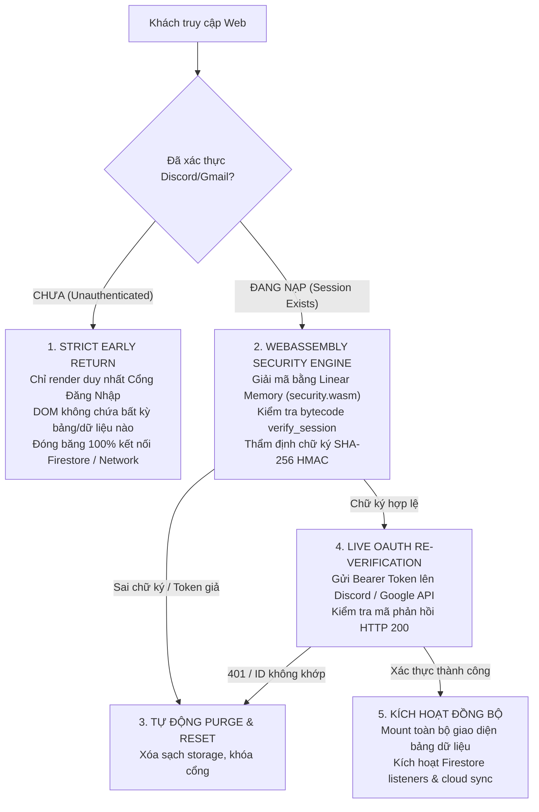

# OAuth Client Security Hardening Skill (WebAssembly & Anti-Tamper)

Bộ quy chuẩn bảo mật bắt buộc khi xây dựng, phát triển hoặc kiểm thử các ứng dụng web có xác thực bên thứ 3 (**Discord, Google/Gmail, GitHub, v.v.**) kết hợp với các dịch vụ đám mây phía máy khách (**Firebase Firestore, Supabase, Cloudflare, IndexedDB**).

Kỹ năng này đúc kết toàn bộ các bài học thực chiến nhằm **triệt tiêu hoàn toàn** các kỹ thuật vượt rào (bypass) phổ biến:
1. **F12 DevTools DOM Element Deletion** (Xóa modal overlay để xem trộm giao diện bên dưới).
2. **`localStorage` Plain-Text Injection** (Gõ lệnh inject JSON giả mạo qua Console để mở khóa web).
3. **Legacy Backdoor Fallbacks** (Để sót code đọc key phiên cũ không qua mã hóa).
4. **DevTools Network Eavesdropping** (Kéo trước dữ liệu database nhạy cảm khi người dùng chưa đăng nhập).
5. **Forged Session Tokens** (Làm giả chữ ký hoặc token mà không qua thẩm định của nhà cung cấp OAuth).

---

## 🎯 Khi Nào Kích Hoạt Kỹ Năng Này (When to Activate)

Kích hoạt kỹ năng này khi:
- Xây dựng hoặc refactor màn hình đăng nhập, cổng kiểm soát truy cập (**OAuth2 Gate, Auth Modal, Protected Routes**).
- Triển khai xác thực qua **Discord OAuth2**, **Google Identity / Firebase Auth**, **GitHub OAuth**.
- Lưu trữ phiên người dùng vào bộ nhớ trình duyệt (**LocalStorage, SessionStorage, IndexedDB**).
- Kết nối các dịch vụ cơ sở dữ liệu thời gian thực (**Firebase Firestore**, **Supabase PostgREST**, **WebSocket**).
- Kiểm toán bảo mật giao diện (Security Audit) trước khi triển khai sản phẩm thực tế (Production Deploy).

---

## 🛑 5 Lỗ Hổng "Kinh Điển" & Kỹ Thuật Bypass Cần Triệt Tiêu

| STT | Lỗ Hổng Thường Gặp (Anti-Pattern) | Cách Kẻ Xấu Bypass (F12 / Console) | Hậu Quả |
| :--- | :--- | :--- | :--- |
| **1** | Cổng đăng nhập chỉ là Modal phủ lên trên (`fixed inset-0`) | Bấm F12 -> Xóa phần tử `<div class="modal">` | Toàn bộ dữ liệu bảng, danh sách thành viên bên dưới lộ diện ngay lập tức. |
| **2** | Lưu thông tin user dạng JSON thuần trong `localStorage` | `localStorage.setItem('user', JSON.stringify({id: 'admin'}))` rồi F5 | Ứng dụng đọc dữ liệu giả và mở khóa toàn bộ quyền Admin/User. |
| **3** | Giữ lại fallback đọc key cũ cho "tương thích ngược" | Inject đúng tên key cũ `localStorage.setItem('old_user_key', ...)` | Vượt qua mọi lớp mã hóa mới do hệ thống vẫn đọc key cũ. |
| **4** | Tự động kéo dữ liệu Cloud/Database khi vừa nạp trang | Bấm F12 -> Tab **Network** -> Xem Preview/Response của Firestore/API | Toàn bộ dữ liệu database bị gửi về máy khách dù chưa hề đăng nhập. |
| **5** | Chỉ kiểm tra token cục bộ, không xác thực với máy chủ OAuth | Tạo token ngẫu nhiên dài 30 ký tự rồi lưu vào máy | Hệ thống tưởng là token hợp lệ và cho phép truy cập. |

---

## 🛡️ 6 Trụ Cột Phòng Thủ Bắt Buộc (The 6 Mandatory Pillars)



---

### Trụ Cột 1: Strict Early-Return Rendering (Chống F12 DOM Deletion)

**Quy tắc bất di bất dịch:** Khi `!user`, React component gốc (`App.tsx` hoặc `ProtectedLayout.tsx`) **BẮT BUỘC RETURN NGAY LẬP TỨC** chỉ có Cổng đăng nhập.

#### ❌ Sai Lầm (Modal Overlay - Dễ bị F12 xóa thẻ):
```tsx
// CỰC KỲ NGUY HIỂM: Bảng dữ liệu vẫn được render bên dưới modal!
export default function App() {
  return (
    <div>
      <Header />
      <SensitiveDataTable data={allMembers} /> {/* Bị lộ khi kẻ xấu xóa modal */}
      {!user && <AuthGateModal />}
    </div>
  );
}
```

#### ✅ Chuẩn Bảo Mật (Strict Early Return):
```tsx
export default function App() {
  const [user, setUser] = useState<User | null>(null);
  const [isVerifying, setIsVerifying] = useState(true);

  if (isVerifying) {
    return <LoadingSecuritySpinner />;
  }

  // TRIỆT TIÊU HOÀN TOÀN: Khi chưa đăng nhập, DOM KHÔNG CÓ BẤT KỲ DỮ LIỆU NÀO!
  if (!user) {
    return (
      <div className="min-h-screen bg-slate-950 flex items-center justify-center">
        <AuthGateModal isOpen={true} onLoginSuccess={setUser} />
      </div>
    );
  }

  // Chỉ khi đã đăng nhập thành công, các component dữ liệu mới được khởi tạo
  return (
    <div>
      <Header user={user} />
      <SensitiveDataTable data={allMembers} />
    </div>
  );
}
```

---

### Trụ Cột 2: WebAssembly Cryptographic Session Envelope

Không bao giờ lưu phiên ở dạng JSON thuần. Dữ liệu phiên phải được đóng gói vào **Phong bì mã hóa WebAssembly** kết hợp chữ ký toàn vẹn SHA-256.

1. **Bộ nhớ tuyến tính cô lập (WASM Linear Memory):**
   - Thuật toán giải mã nằm trong bytecode nhị phân compiled (`public/security.wasm`), không thể đọc logic thuần qua file JS source maps.
   - Thao tác xáo trộn và giải mã diễn ra trực tiếp trong mảng byte cô lập của WebAssembly (`memory.buffer`).
2. **Bytecode Session Verification:**
   - Hàm `verify_session(token_len, timestamp)` thực thi trực tiếp bằng chỉ lệnh WebAssembly native (i32/i64).
3. **Chữ ký toàn vẹn SHA-256 (HMAC with Salt):**
   - Mỗi phiên lưu trữ gồm: `{ encryptedData, token, timestamp, expiresAt, hash }`.
   - `hash = SHA256(userId + ":" + token + ":" + timestamp + ":" + SECRET_SALT)`.
   - Nếu bất kỳ ai dùng F12 sửa dù chỉ 1 ký tự trong `localStorage`, chữ ký sẽ sai lệch ngay -> Hệ thống tự động xóa sạch phiên và khóa cổng.

---

### Trụ Cột 3: Loại Bỏ 100% Cửa Sau (Zero Legacy Fallback) & Anti-Tamper Watcher

1. **Xóa sạch fallback cũ:**
   - Tuyệt đối không viết: `if (!secureSession) return readOldPlaintextStorage();`. Đây chính là lỗ hổng backdoor tiếp tay cho việc inject `localStorage.setItem('old_key', ...)`.
2. **Chủ động dọn dẹp key rác:**
   - Ngay khi ứng dụng khởi chạy, luôn chủ động gọi `localStorage.removeItem('old_plaintext_key')`.
3. **Giám sát can thiệp Storage thời gian thực:**
   ```typescript
   // Lắng nghe sự kiện can thiệp storage từ Console F12
   window.addEventListener('storage', (e) => {
     if (e.key === 'guild_nien_du_discord_user' || e.key === 'legacy_auth') {
       localStorage.removeItem(e.key);
       verifyAuthSession(); // Buộc thẩm định lại ngay lập tức
     }
   });
   ```

---

### Trụ Cột 4: Live OAuth Token Re-verification (Xác Thực Trực Tiếp Với Provider)

Tránh việc tin tưởng tuyệt đối vào dữ liệu lưu trên máy khách. Trong quá trình khởi động lại phiên làm việc:
1. Giải mã Bearer Token từ bộ nhớ WebAssembly.
2. Gửi request kiểm tra danh tính trực tiếp lên máy chủ OAuth chính thống:
   - **Discord:** `GET https://discord.com/api/users/@me` với header `Authorization: Bearer <token>`.
   - **Google:** `GET https://www.googleapis.com/oauth2/v3/userinfo` với header `Authorization: Bearer <token>`.
3. **Quy tắc xử lý:**
   - Nếu máy chủ OAuth trả về `HTTP 401 Unauthorized` (token giả, token hết hạn, hoặc bị thu hồi) -> **HỦY PHIÊN NGAY LẬP TỨC**.
   - Nếu `response.id !== session.userId` (dùng token của tài khoản A để mạo danh tài khoản B) -> **HỦY PHIÊN NGAY LẬP TỨC**.

---

### Trụ Cột 5: Đóng Băng Kết Nối Mạng Khi Chưa Xác Thực (Network Request Freezing)

Khi người dùng đang ở Cổng Đăng Nhập, tab **DevTools > Network** bắt buộc phải hoàn toàn yên lặng đối với các yêu cầu dữ liệu đám mây:

1. **Khóa kết nối Cloud Database:**
   ```typescript
   // Lắng nghe Firestore thời gian thực
   useEffect(() => {
     // BẮT BUỘC: Nếu chưa có phiên xác thực, KHÔNG BAO GIỜ gọi onSnapshot hay pullFromCloud
     if (!isStorageHydrated || !authenticatedUser) return;

     const unsubscribe = subscribeToCloud((incomingData) => {
       applyCloudDataToState(incomingData);
     });

     return () => unsubscribe();
   }, [isStorageHydrated, authenticatedUser]);
   ```
2. **Khóa trình lắng nghe Firebase Auth:**
   ```typescript
   // Google Auth / Sheets listener
   useEffect(() => {
     // Không kích hoạt accounts:lookup khi chưa vượt qua cổng OAuth chính
     if (!authenticatedUser) return;
     const unsubscribe = initAuth((user) => setCurrentUser(user));
     return () => unsubscribe();
   }, [authenticatedUser]);
   ```

---

### Trụ Cột 6: Hiểu Đúng Bản Chất Client API Key (Firebase / Supabase)

- **Sự thật về API Key phía Client:**
  - Key `AIza...` của Firebase hay `anon-key` của Supabase là **Mã định danh công khai (Public by Design)**.
  - Việc key này xuất hiện trên Network tab là cơ chế hoạt động bình thường của mọi ứng dụng Web/App trên thế giới. Kẻ xấu có key này **KHÔNG THỂ** vào Firebase Console và **KHÔNG THỂ** xóa cơ sở dữ liệu.
- **Lớp bảo vệ tối hậu nằm ở Backend Security Rules:**
  - Mọi ứng dụng có Firebase/Supabase bắt buộc phải có quy tắc bảo mật máy chủ (`firestore.rules`):
    ```javascript
    rules_version = '2';
    service cloud.firestore {
      match /databases/{database}/documents {
        // MẶC ĐỊNH TỪ CHỐI TẤT CẢ (Default Deny)
        match /{document=**} {
          allow read, write: if false;
        }
        
        // Chỉ cho phép đọc/ghi theo đúng định dạng và quyền hạn được kiểm soát
        match /guilds/{guildId} {
          allow read: if true;
          allow write: if isValidGuildDoc(request.resource.data, guildId);
        }
      }
    }
    ```

---

## 📋 Bảng Kiểm Tra An Toàn Trước Khi Triển Khai (Pre-flight Checklist)

Trước khi nghiệm thu bất kỳ dự án web có đăng nhập nào, chạy qua bảng kiểm tra 6 bước sau:

- [ ] **1. Kiểm tra DOM:** Mở F12 -> Xóa phần tử Modal đăng nhập. Kết quả: Trang web phải rỗng (`#root` không chứa bảng, dữ liệu hay nút chức năng).
- [ ] **2. Kiểm tra Console Injection:** Gõ `localStorage.setItem('user', JSON.stringify({id: 'fake'}))` và F5. Kết quả: Web vẫn khóa ở Cổng Đăng Nhập và key rác bị tự động xóa.
- [ ] **3. Kiểm tra Fallback cũ:** Tìm kiếm toàn bộ codebase xem còn từ khóa nào đọc `localStorage.getItem('legacy_...')` không. Loại bỏ 100%.
- [ ] **4. Kiểm tra Network Tab:** Mở tab Network -> Tải trang khi chưa đăng nhập. Kết quả: Không có kết nối tới Firestore (`channel?` hay `onSnapshot`) và không có dữ liệu nghiệp vụ nào bị tải về.
- [ ] **5. Kiểm tra WebAssembly:** Kiểm tra file `public/security.wasm` được phục vụ với `Content-Type: application/wasm` và có mảng fallback `EMBEDDED_WASM_BYTES` trong code để chạy ổn định khi offline.
- [ ] **6. Kiểm tra Security Rules:** Kiểm tra `firestore.rules` hoặc Supabase RLS đã bật và có quy tắc Default Deny cho toàn bộ các collection chưa được ủy quyền.
